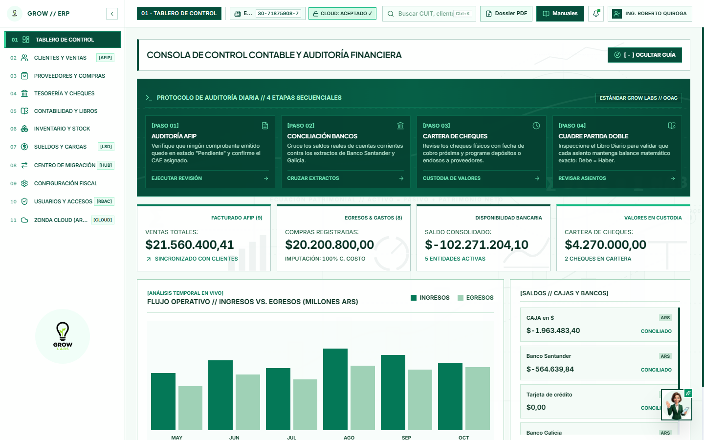
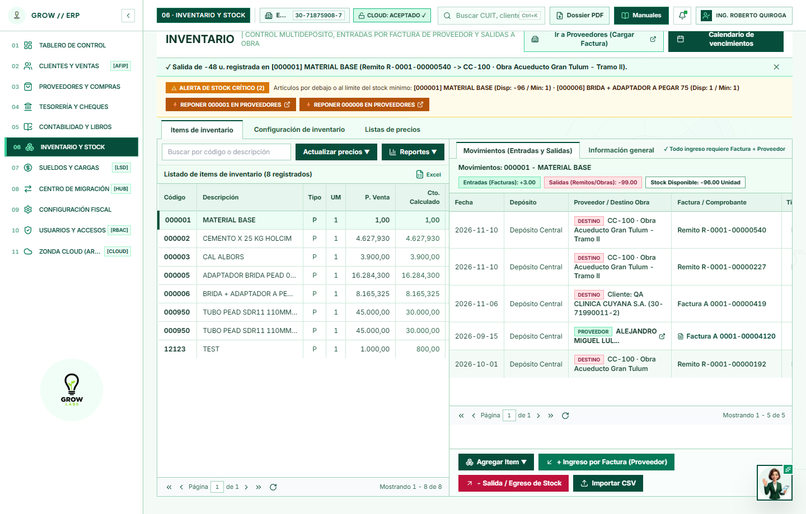
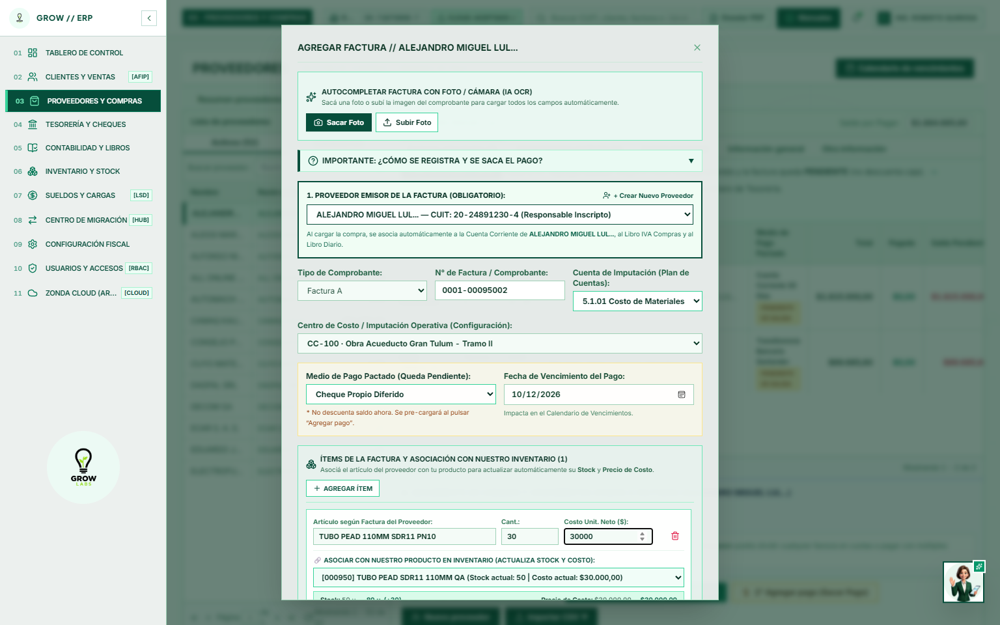
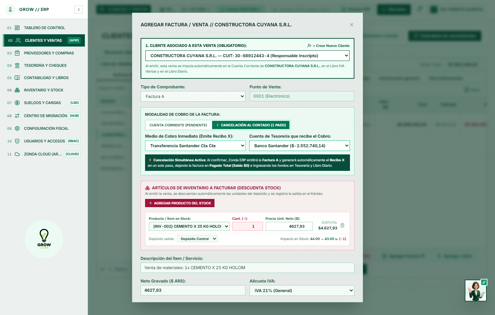
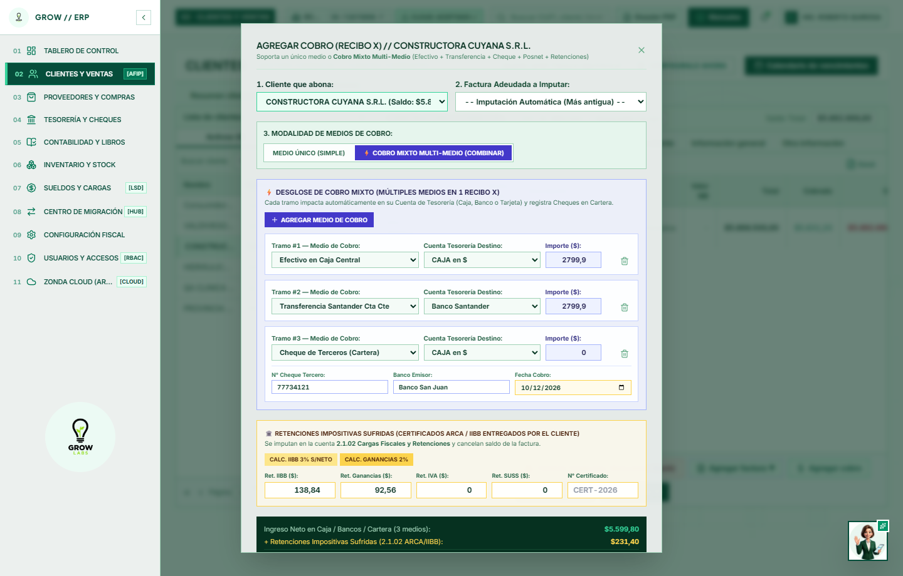
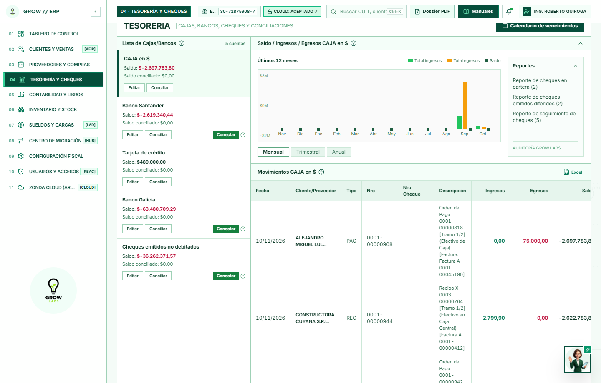
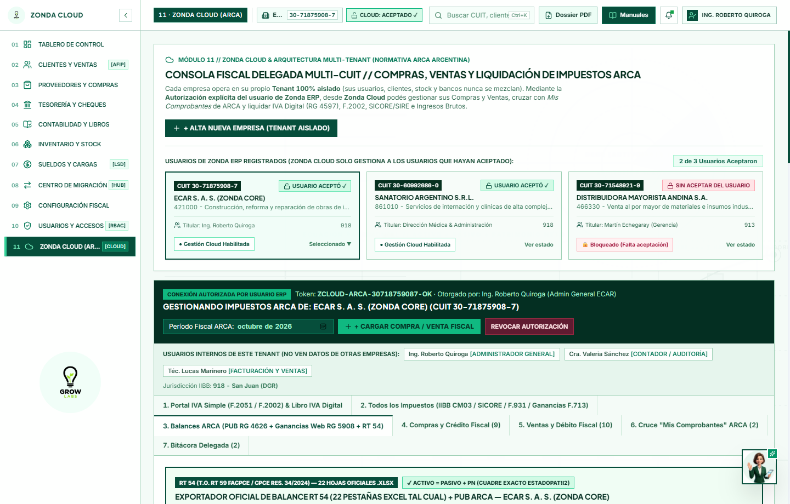
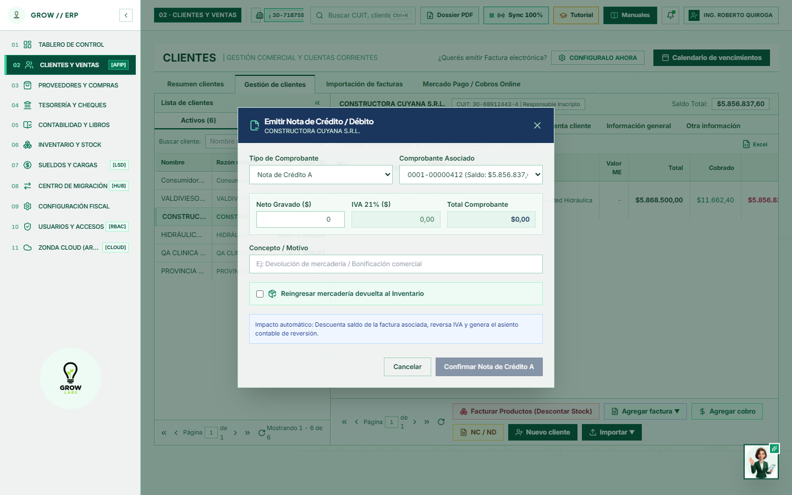
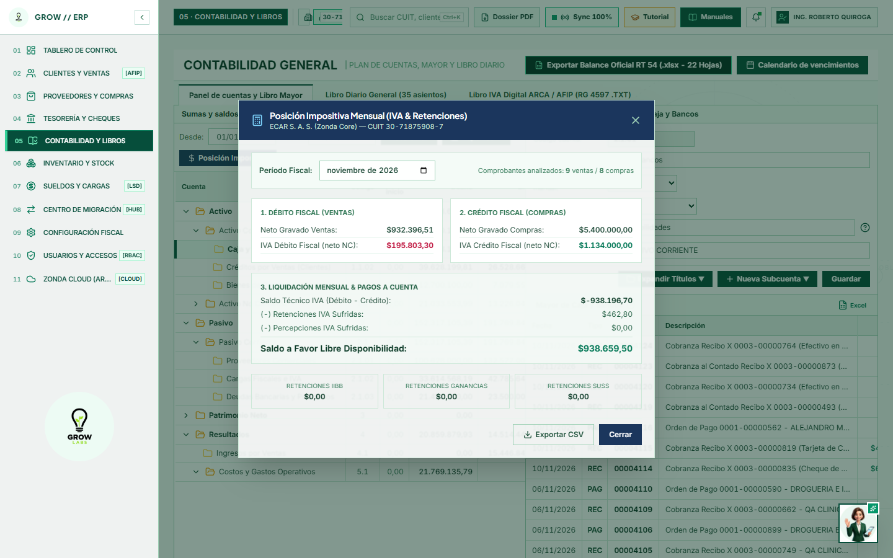
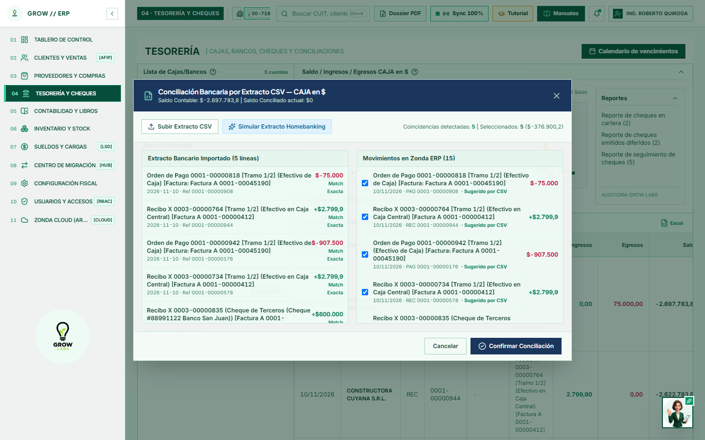

<p align="center">
  
</p>

<h1 align="center">Zonda ERP | Sistema de Gestión Contable, Operativo y Financiero</h1>

<p align="center">
  <strong>Grow Labs · Ecosistema Sanatorio Argentino</strong><br>
  Plataforma Cloud Multi-Tenant de Gestión Empresarial, Auditoría Sanitaria, Facturación Electrónica ARCA, Conciliación Bancaria y Balance Oficial FACPCE RT 54.
</p>

<p align="center">
  
  
  
  
  
  
</p>

---

## 📌 Tabla de Contenidos
1. [¿Qué es Zonda ERP?](#-qué-es-zonda-erp)
2. [Ventajas Competitivas vs. ERPs Tradicionales (Colppy, etc.)](#-ventajas-competitivas-vs-erps-tradicionales)
3. [Recorrido Visual y Funcionalidades Paso a Paso](#-recorrido-visual-y-funcionalidades-paso-a-paso)
   * [01. Tablero de Control y Aislamiento Multi-Tenant](#01-tablero-de-control-y-aislamiento-multi-tenant)
   * [02. Inventario, Kardex y Alertas de Stock Crítico](#02-inventario-kardex-y-alertas-de-stock-crítico)
   * [03. Compras, Proveedores y Trazabilidad de Stock](#03-compras-proveedores-y-trazabilidad-de-stock)
   * [04. Ventas, Facturación Electrónica y Descuento de Stock](#04-ventas-facturación-electrónica-y-descuento-de-stock)
   * [05. Cobros y Pagos Mixtos Multi-Medio + Retenciones Fiscales](#05-cobros-y-pagos-mixtos-multi-medio--retenciones-fiscales)
   * [06. Tesorería con Trazabilidad por Tramos y Libro Diario](#06-tesorería-con-trazabilidad-por-tramos-y-libro-diario)
   * [07. Zonda Cloud y Balance Oficial RT 54 (22 Hojas Excel)](#07-zonda-cloud-y-balance-oficial-rt-54-22-hojas-excel)
   * [08. Notas de Crédito y Débito con Reversión de IVA y Stock](#08-notas-de-crédito-y-débito-con-reversión-de-iva-y-stock)
   * [09. Posición Impositiva Mensual Automática](#09-posición-impositiva-mensual-automática)
   * [10. Conciliación Bancaria Inteligente por Extracto CSV](#10-conciliación-bancaria-inteligente-por-extracto-csv)
4. [Sincronización Omnicanal en Tiempo Real](#-sincronización-omnicanal-en-tiempo-real)
5. [Arquitectura Técnica y Tecnologías](#-arquitectura-técnica-y-tecnologías)
6. [Puesta en Marcha Local](#-puesta-en-marcha-local)

---

## 🚀 ¿Qué es Zonda ERP?

**Zonda ERP** es una solución integral de software administrativo, contable y financiero diseñada con estándares clínicos de alta precisión para organizaciones médicas, PyMEs comerciales y estudios contables. 

A diferencia de los sistemas contables tradicionales que funcionan en silos desarticulados, **Zonda ERP vincula la operación real con la contabilidad formal de forma inmediata**: cada venta descuenta stock real y genera el costo de mercadería vendida (CMV); cada compra incrementa el depósito e impacta la deuda comercial; cada cobranza o pago multimodal desglosa retenciones de ley y genera partidas dobles perfectas en el Libro Diario.

---

## 💎 Ventajas Competitivas vs. ERPs Tradicionales

| Característica | ERP Tradicional (Colppy / Otros) | Zonda ERP (Grow Labs) |
| :--- | :--- | :--- |
| **Balance Legal FACPCE** | Reporte plano genérico de sumas y saldos. | **Balance Oficial RT 54 en 22 Hojas `.xlsx` completas** con inspector en vivo y mapeo de anexos. |
| **Operación al Contado** | Requiere 2 pantallas: facturar en Ventas y luego ir a Tesorería a emitir el recibo. | **⚡ Cancelación en 1 Solo Paso**: emite Factura + Recibo X + cobro multimodal dejando saldo $0 en segundos. |
| **Medios de Cobro y Pago** | Monomedio básico o interfaces complejas. | **Cobros y Pagos Mixtos N-Tramos**: Efectivo + Cheques Diferidos + Transferencias + Retenciones en un solo comprobante. |
| **Trazabilidad de Stock** | Desconectada de la factura del proveedor. | **Kardex estricto**: cada unidad ingresada rastrea el CUIT, proveedor, factura y precio de compra. |
| **Multi-Tenant y Delegación Contable** | Requiere cerrar e iniciar sesión para cambiar de CUIT. | **Zonda Cloud Multi-Tenant**: cambio instantáneo entre CUITs con permisos de auditoría para el estudio contable. |
| **Sincronización de Pestañas** | Desincronización frecuente; requiere recargar F5. | **Bus Omnicanal `BroadcastChannel`**: cambios en una pestaña actualizan saldos y stock en todas las ventanas abiertas al instante. |
| **Sueldos y CCT** | Módulo externo tercerizado con costo adicional. | **Módulo de Sueldos integrado** con escalas de Convenios Colectivos (Sanidad CCT 122/75, etc.). |
| **Onboarding** | Guías estáticas en texto o videos desactualizados. | **Tutorial Interactivo en Vivo con Modo Guía Flotante** que acompaña al operador sobre la UI real. |

---

## 📸 Recorrido Visual y Funcionalidades Paso a Paso

### 01. Tablero de Control y Aislamiento Multi-Tenant
* **Indicadores Financieros Clave (KPIs):** Ventas totales del mes, compras acumuladas, disponibilidad bancaria real y saldo en custodia de cheques de terceros.
* **Aislamiento Estricto por CUIT:** Sesiones segregadas por tenant que garantizan que los datos contables y bancarios pertenezcan exclusivamente a la empresa en sesión.
* **Buscador Omnicanal (Ctrl + K):** Localización inmediata de comprobantes, CUITs, productos o asientos contables.

<p align="center">
  
</p>

---

### 02. Inventario, Kardex y Alertas de Stock Crítico
* **Alertas Inteligentes de Quiebre de Stock:** Detección automática en tiempo real de artículos con existencia inferior al stock de seguridad.
* **Kardex y Trazabilidad por Lote:** Registro inalterable de cada ingreso y egreso con vinculación directa al comprobante respaldatorio.
* **Botón de Reposición en 1 Clic:** Al detectar stock crítico, permite saltar directamente a Proveedores con la orden preconfigurada.

<p align="center">
  
</p>

---

### 03. Compras, Proveedores y Trazabilidad de Stock
* **Recepción con Ingreso de Inventario:** El registro de la factura de compra nutre de forma directa las existencias del depósito sin pasos adicionales.
* **Cuentas Corrientes y Plazos de Pago:** Gestión de facturas pendientes con indicación de vencimiento y cálculo de días de crédito.
* **Escaneo Inteligente:** Compatibilidad con procesamiento rápido de facturas para minimizar errores de transcripción manual.

<p align="center">
  
</p>

---

### 04. Ventas, Facturación Electrónica y Descuento de Stock
* **Emisión Electrónica con QR ARCA (RG 4892):** Generación de Facturas A, B, C y M con autorización y CAE.
* **Descuento de Stock Automático y Asiento CMV:** Cada venta rebaja el almacén y asienta contablemente la disminución patrimonial contra el Costo de Ventas.
* **Venta en Cuenta Corriente o Contado en 1 Paso:** Flexibilidad total para operar a plazo o liquidar al contado en el mismo acto de emisión.

<p align="center">
  
</p>

---

### 05. Cobros y Pagos Mixtos Multi-Medio + Retenciones Fiscales
* **Cobranzas Combinadas (`Recibo X`):** Combina efectivo, transferencias bancarias, cheques de terceros y cobro digital en una única transacción.
* **Pagos a Proveedores Multitramo (`Orden de Pago`):** Cancela obligaciones con emisión de cheques propios diferidos, endoso de cheques en cartera y transferencias.
* **Retenciones Impositivas en Origen:** Liquidación automática de retenciones de **Ingresos Brutos (IIBB)**, **Impuesto a las Ganancias (RG 830)**, **IVA** y **SUSS**.

<p align="center">
  
</p>

---

### 06. Tesorería con Trazabilidad por Tramos y Libro Diario
* **Desglose `[Tramo X/N]` en Cajas y Bancos:** Cuando un cobro o pago es mixto, la tesorería audita cada tramo en la cuenta bancaria o caja correspondiente de forma discriminada.
* **Libro Diario en Partida Doble:** Asientos contables automáticos con balanceo estricto `Debe = Haber`.
* **Custodia de Cheques:** Cartera de valores recibidos lista para depósito, canje o endoso a proveedores.

<p align="center">
  
</p>

---

### 07. Zonda Cloud y Balance Oficial RT 54 (22 Hojas Excel)
* **Delegación Estudio Contable (Zonda Cloud):** La empresa puede autorizar a su contador externo para auditar asientos, plan de cuentas y libros impositivos sin interrumpir la operación.
* **Exportador Oficial RT 54 (22 Pestañas):** Generación en un clic del libro Excel profesional bajo la **Resolución Técnica N° 54 de la FACPCE** (`CONTROLES`, `CARATULA`, `ESP`, `ER`, `EEPN`, `EFE`, `NOTAS`, `ANEXOS`).
* **Inspector Contable en Vivo:** Vista previa de validaciones de sumas, activos, pasivos y patrimonio neto antes de emitir los estados contables finales.

<p align="center">
  
</p>

---

### 08. Notas de Crédito y Débito con Reversión de IVA y Stock
* **Vinculación Directa con la Factura Original:** Descuenta automáticamente el saldo adeudado del cliente o proveedor.
* **Reingreso Opcional de Mercadería:** Opción de devolver las unidades al depósito aumentando el stock disponible.
* **Asiento Contable Inverso:** Reversa automáticamente el Neto Gravado, el IVA Débito/Crédito Fiscal y la Cuenta Corriente.

<p align="center">
  
</p>

---

### 09. Posición Impositiva Mensual Automática
* **Liquidación de IVA en Tiempo Real:** Cálculo automático del Débito Fiscal (ventas netas de NC) y Crédito Fiscal (compras netas de NC).
* **Compensación de Pagos a Cuenta:** Cruce contra Retenciones y Percepciones de IVA sufridas para determinar el Saldo Técnico y Saldo de Libre Disponibilidad.
* **Exportación a CSV:** Reporte fiscal mensual descargable para conciliación de declaraciones juradas (F. 2002 ARCA).

<p align="center">
  
</p>

---

### 10. Conciliación Bancaria Inteligente por Extracto CSV
* **Carga de Extractos Homebanking:** Compatible con archivos CSV estándar de bancos argentinos (Galicia, Santander, Nación, Macro, etc.).
* **Motor de Matching Inteligente:** Sugiere coincidencias automáticas por importe exacto y cercanía de fecha (±3 días).
* **Control Dual de Saldos:** Visualización permanente del **Saldo Contable en Libros** frente al **Saldo Conciliado en Banco**.

<p align="center">
  
</p>

---

## ⚡ Sincronización Omnicanal en Tiempo Real

Zonda ERP implementa un bus de comunicación de baja latencia mediante `BroadcastChannel` (`zonda_erp_realtime_sync_channel_v1`) y persistencia asíncrona en Supabase:

```
[ Pestaña 1: Ventas ] ---> Emite Factura y Recibo X
         │
         ├──> BroadcastChannel (Memoria Inter-Pestaña)
         │       ├──> [ Pestaña 2: Tesorería ] actualiza saldo bancario en vivo
         │       ├──> [ Pestaña 3: Inventario ] descuenta stock físico al instante
         │       └──> [ Pestaña 4: Contabilidad ] asienta Libro Diario y RT 54
         │
         └──> Supabase Snapshot (Persistencia Cloud por Tenant)
```

Al pulsar el botón **`🟢 Sync 100%`** en la barra superior, el usuario puede auditar los eventos en tránsito y forzar la sincronización atómica de todas las entidades.

---

## 🛠️ Arquitectura Técnica y Tecnologías

* **Frontend:** [React 19](https://react.dev/) + [TypeScript](https://www.typescriptlang.org/) + [Vite 8](https://vitejs.dev/)
* **Diseño y Estilos:** [Tailwind CSS 3.4](https://tailwindcss.com/) (Estética *Limpia y Clínica* Quality-QOAG, bordes redondeados `rounded-xl`, tipografía sans-serif y azul institucional `#1b365d`)
* **Iconografía:** [Lucide React](https://lucide.dev/)
* **Base de Datos y Cloud:** [Supabase](https://supabase.com/) (PostgreSQL + Row-Level Security)
* **Generación Documental:**
  * Estados Contables RT 54 de 22 Hojas con formato Excel binario (`xlsx`)
  * Facturas Electrónicas PDF con código QR nativo de ARCA (RG 4892)
  * Recibos de Sueldo en PDF homologados para Sanidad
  * Libro IVA Digital ARCA (RG 4597)
* **Testing & QA Automatizado:** [Playwright](https://playwright.dev/) para auditoría de navegación e interfaces

---

## 💻 Puesta en Marcha Local

### Prerrequisitos
* **Node.js** v20 o superior
* **npm** v10 o superior

### Instalación y Ejecución

1. **Clonar el repositorio:**
   ```bash
   git clone https://github.com/lucasmmg12/zonda.git
   cd zonda
   ```

2. **Instalar dependencias:**
   ```bash
   npm install
   ```

3. **Configurar variables de entorno (Opcional para persistencia Supabase):**
   Crear un archivo `.env` en la raíz del proyecto:
   ```env
   VITE_SUPABASE_URL=tu_supabase_url
   VITE_SUPABASE_ANON_KEY=tu_supabase_anon_key
   ```

4. **Iniciar en modo desarrollo:**
   ```bash
   npm run dev
   ```
   Abrir en el navegador: [http://localhost:5173/](http://localhost:5173/)

5. **Compilar para producción:**
   ```bash
   npm run build
   ```

---

<p align="center">
  Desarrollado con dedicación técnica y rigor clínico por <strong>Grow Labs</strong> para el ecosistema de <strong>Sanatorio Argentino</strong>.
</p>
